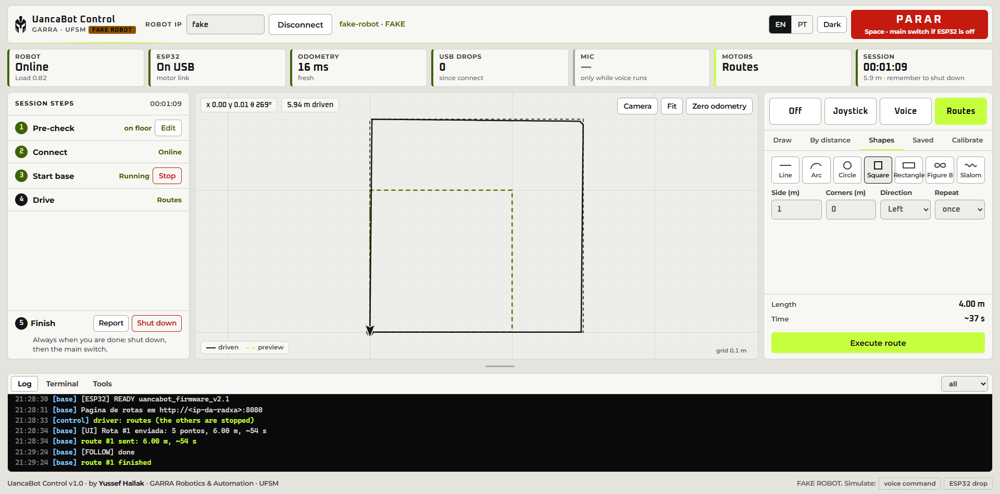

# UancaBot

**An autonomous mobile robot built at the GARRA Robotics Lab, UFSM.**

UancaBot is a ROS 2 mobile robot platform for work in real environments. It is built to move on its own, and to work naturally with the people around it.

## What it does

- **Drives autonomously** along planned routes, with its position tracked from its wheels in real time.
- **Understands spoken commands** in Portuguese, fully offline, so it works anywhere, with no internet.
- **Can be driven by hand** with a joystick over Wi-Fi when someone needs to take over.
- **Stays safe**: an emergency stop, speed limits and a stop command that always wins.
- **Runs onboard**: everything runs on the robot's own computer, packaged so it starts the same way every time.
- **Has its own control app**: one screen to start the robot, choose joystick, voice or routes, watch the map live, and end with a session report.

## My work

I work across the whole robot: the hardware and electronics, motor control, the robot software, and the interfaces that let people command it by voice and by hand.

## Built with

ROS 2, Linux, Docker, Python, C++, ESP32 and Arduino, with offline speech recognition.

## What's next

Full autonomous missions, perception, and richer interaction between the robot and the people who work with it.

## About

UancaBot is developed at the GARRA Robotics Lab, Universidade Federal de Santa Maria. Page by Yussef Omar Hallak, undergraduate research fellow.

The source code is private. Reviewers and hiring teams can request access at yussefomarh@gmail.com.
